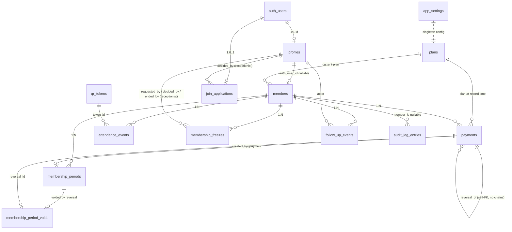

# Phase 3A Final Design — Consolidated Database Design

Date: 2026-11-17 · Status: DESIGN ONLY (consolidation) · Phase 3B NOT authorized

This is the single consolidated Phase 3A deliverable. It supersedes nothing, deletes
nothing, and modifies nothing: `PHASE_3A_REVIEW.md`,
`PHASE_3A_TECHNICAL_CLARIFICATION.md`, `DATABASE_DESIGN.md`, `SECURITY_POLICY.md`,
`THREAT_MODEL.md` and all application source are preserved untouched. The original
Phase 3A design report was delivered in-chat and is consolidated here.

Sources consolidated: the owner's confirmed decision set (this document §1),
`src/utils/membership.ts`, `src/utils/payment.ts`, `src/types/domain.ts`,
`src/app/(reception)/{fees,freeze,plans}.tsx`, and the two prior Phase 3A reports.

Label key used throughout:
- **[OWNER]** — confirmed owner decision (2026-11-17). Binding.
- **[C1]** — previously confirmed freeze-approval decision. Binding.
- **[REC]** — technical design recommendation carried from prior reports (not owner-confirmed).
- **[ASSUMPTION]** — safe technical assumption documented here, not owner-confirmed.
- **[UNRESOLVED]** — genuinely undecided; see `PHASE_3A_UNRESOLVED_ITEMS.md`. Nothing enabled silently.

---

## 1. Confirmed decision register (owner, 2026-11-17)

### 1.1 Membership and freeze
| ID | Decision | Label |
|---|---|---|
| O-01 | Membership validity uses calendar months. | [OWNER] |
| O-02 | Freeze days are inclusive (window Nov 20–24 = 5 frozen days). | [OWNER] |
| O-03 | Early unfreeze rolls back unused freeze days. | [OWNER] |
| O-04 | Renewal while frozen is blocked. | [OWNER] |
| O-05 | Renewal after expiry starts from the actual renewal date. | [OWNER] |
| O-06 | No freeze duration or count limit. | [OWNER] |
| O-07 | Only active memberships can request a freeze. | [OWNER] (interpreted §2.1) |
| O-08 | Receptionist approves or rejects freeze requests; Owner view-only. (= C1) | [OWNER] |
| O-09 | An approved freeze pauses membership validity. | [OWNER] |
| O-10 | A member scanning the gym QR automatically ends an active freeze; the scan resumes membership and counts as successful attendance. | [OWNER] |
| O-11 | Frozen days are excluded from the 30-day inactivity calculation. | [OWNER] |

### 1.2 Discounts
| ID | Decision | Label |
|---|---|---|
| O-12 | Only Receptionists can apply discounts. | [OWNER] |
| O-13 | No discount percentage limit (valid-range constraint §5.3 applies). | [OWNER] |
| O-14 | A saved member discount is a suggestion only; the receptionist chooses per payment. | [OWNER] |
| O-15 | Owner has read-only visibility of who received discounts and the amounts. | [OWNER] |
| O-16 | Record original price, discount %, discount amount, final price, and responsible receptionist. | [OWNER] |

### 1.3 Payments
| ID | Decision | Label |
|---|---|---|
| O-17 | Receptionist records AND verifies payments. | [OWNER] |
| O-18 | Owner has read-only access to individual payment records. | [OWNER] |
| O-19 | Receptionist can initiate full and partial reversals; Owner view-only. | [OWNER] |
| O-20 | Reversals must reference the original verified payment. | [OWNER] |
| O-21 | Cumulative reversals cannot exceed the original payment. | [OWNER] |
| O-22 | Original payment records remain immutable. | [OWNER] |
| O-23 | Full reversal immediately invalidates only the membership period linked to that payment; newer valid periods remain active. | [OWNER] |
| O-24 | Partial reversals do not invalidate membership. | [OWNER] |
| O-25 | Reports show gross collections, reversals, net revenue, judged by the payment **recording date**. | [OWNER] |
| O-26 | Pending and rejected payments are never revenue. | [OWNER] |
| O-27 | Owner can export monthly and custom-range reports to Excel/PDF. | [OWNER] (app-layer, later phase) |
| O-28 | Owner report columns: member name, amount, method, payment date, UTR/reference, status, responsible receptionist. | [OWNER] |

### 1.4 Attendance
| ID | Decision | Label |
|---|---|---|
| O-29 | Every successful scan counts, including repeat scans by the same member. | [OWNER] |
| O-30 | Monthly attendance = total successful scans, not unique members. | [OWNER] |
| O-31 | Check-in only; no check-out or entry/exit tracking. | [OWNER] |
| O-32 | Expired members can continue attending; counted as ordinary successful attendance. | [OWNER] |
| O-33 | No expired-membership warning during check-in. | [OWNER] |
| O-34 | After renewal is verified, the new membership starts from the actual renewal date. | [OWNER] |
| O-35 | Failed QR scans are not stored as attendance records. | [OWNER] |
| O-36 | Inactive = 30 consecutive **non-frozen** days without successful attendance; successful attendance resets it. | [OWNER] |

Previously confirmed: **[C1]** receptionist freeze approval (O-08 restates it).

---

## 2. Interpretations and technical assumptions (explicit, not invented silently)

### 2.1 O-07 "only active memberships" — interpreted with the demo's rule
`freeze.tsx` blocks expired, payment-pending and already-frozen members, and admits
"active or expiring". The domain (`membership.ts`) treats `expiring` as an active
membership inside its last 7 days — `expiring` is not a lapsed state. Interpretation:
**O-07 = membership not expired (status ∈ {active, expiring}) at decision time**,
re-checked server-side at approval (prior clarification §1.2 stands). This is the only
reading consistent with the implemented eligibility code and is recorded here as an
interpretation, not a new rule.

### 2.2 O-09 "pause" + O-03 "rollback unused" — one arithmetic (§4.4)
Pause semantics and extend-then-rollback are **the same math**; the design implements the
event-driven form (extend at approval, subtract unused on early unfreeze) because it needs
no scheduled job and stays exact under all interleavings. §4.4 proves the equivalence.

### 2.3 O-13 "no discount limit" vs data validity
"No limit" is a policy statement; the constraint `discount_pct BETWEEN 0 AND 100` remains
a data-validity range, not a policy ceiling. 100% discount yields `payable = 0`;
recommendation [REC]: relax the money CHECK to `payable >= 0` (a fully-discounted free
membership is a legitimate record). `original_price > 0` still holds. Flagged as [REC].

### 2.4 O-32/O-33 "expired can attend, silently"
Attendance gating knows membership state but never surfaces an expired warning; the
expired check-in is indistinguishable in flow from an active one (no extra confirm, no
badge). UI notes for the later live-wiring phase: §10.

### 2.5 Safe technical assumptions [ASSUMPTION] (carried, owner not asked)
- **Money**: `numeric(12,2)` INR, whole-rupee rounding
  (`payable = round(original_price × (1 − discount_pct/100.0), 0)` — identical to
  `computePayable`); single currency `INR` enforced.
- **QR rotation**: server-minted, time-limited, 60-second validity (configurable in
  `app_settings`), per-member-per-token uniqueness (replay-safe without breaking
  multiple check-ins/day); SHA-256 hash storage, plaintext transient.
- **UPI settings**: owner-only update via function; receptionist read (needed for the
  payment QR display). [REC carried]
- **Join application decision**: receptionist decides (carried [REC]; owner not addressed).
- **Plan prices**: owner-only changes via `update_plan_price`; receptionist requests plan
  assignments applied at next verified payment (carried [REC], matches `plans.tsx`).
- **MFA**: AAL2 gates on authority functions remain the recommended posture [REC] —
  operationally reconsidered for receptionist daily flows in UNRESOLVED items.

---

## 3. Final schema (13 tables)

Changes vs the prior draft: **+`membership_period_voids`** (append-only period
invalidation — resolves the in-place `voided_at` conflict, §6.3), **+`discount_amount`**
on payments (O-16), **+freeze attribution fields** (`ended_via`), discount writes move to
receptionist authority (O-12), reversal authority moves to receptionist (O-19).

| # | Table | Purpose / key columns | Writes |
|---|---|---|---|
| 1 | `profiles` | 1:1 `auth.users`; `role` immutable (trigger); display name | service-only role changes |
| 2 | `plans` | name, duration enum (monthly/quarterly/halfYearly/yearly), `price`, `is_active`, `currency` | `update_plan_price` (owner) |
| 3 | `members` | identity, `plan_id`, `price_locked` (nullable until first verified payment), `discount_pct` (suggestion, O-14), `pending_plan_id` + `pending_plan_requested_by`, `membership_end`, `joined_on`, `archived_at` | functions only (except contact-field function path) |
| 4 | `membership_periods` | `member_id`, `start_date` (coverage start), `end_date` (computed at creation), `plan_id`, `created_by_payment` FK, `price_applied` | function-inserted at verification |
| 5 | `membership_period_voids` | **NEW, append-only**: `period_id` (UNIQUE — a period voids once), `reversal_id` FK → payments, `voided_by`, `created_at`. No UPDATE/DELETE grants; no in-place mutation of periods | `create_reversal` (full) |
| 6 | `payments` | append-only; `entry_type ∈ {payment, reversal}`; `original_price`, `discount_pct`, **`discount_amount`** (= original − payable, stored per O-16), `payable`, `currency='INR'`, `method ∈ {upi, cash}`, `utr` (unique when present), `state ∈ {awaitingVerification, verified, rejected}`, `recorded_by` (receptionist), `verified_by`, `recorded_at`, `verified_at`, `reversal_of` (self-FK, must reference `entry_type='payment'`, no chains), `receipt_issued`, `note` | `create_payment` (receptionist), `verify_payment`/`reject_payment` (receptionist), `create_reversal` (receptionist) |
| 7 | `attendance_events` | `member_id`, `token_id` FK, `door` text label (O-31), `status ∈ {verified, failed, frozen}` — **but only verified rows are ever inserted by the live flow** (O-35: failed scans not stored; `failed`/`frozen` retained as enum values for analytical back-compat only) | `check_in` (member self) |
| 8 | `membership_freezes` | `member_id`, `start_date`, `end_date`, `reason`, `state ∈ {pending, approved, rejected, ended}`, `requested_by`, `decided_by`, `decided_at`, `extension_days` (approved inclusive days), `ended_at`, `ended_via ∈ {receptionist, scan}`, `ended_by` | `request_freeze`, `decide_freeze`, `end_freeze` (receptionist); scan path inside `check_in` |
| 9 | `join_applications` | applicant data, `state`, verification flags; `auth_user_id` nullable; `decided_by` (receptionist) | `decide_application` |
| 10 | `follow_up_events` | per-member follow-up history: `member_id`, `actor`, `channel ∈ {called, messaged, visited}`, `outcome ∈ {won, lost, open}`, `note` | staff insert |
| 11 | `qr_tokens` | `token_hash` (SHA-256, plaintext never stored), `purpose CHECK (purpose='attendance')`, `expires_at`, `minted_by`; unique `(member_id, token_id)` consumption via attendance FK | `mint_attendance_token` (staff) |
| 12 | `audit_log_entries` | actor, role, action, table, row id, old/new jsonb, at | triggers + functions (append-only) |
| 13 | `app_settings` | singleton: gym date timezone, UPI id/QR, `attendance_token_validity_seconds` (default 60) | `update_gym_settings` (owner) |

Deletion behavior: every domain FK is RESTRICT; members archive, plans deactivate;
only `profiles.id` / `join_applications.auth_user_id` cascade from `auth.users`.
`qr_tokens` purge (> 30 days) skips tokens referenced by attendance events.

---

## 4. Membership lifecycle — exact mechanics

### 4.1 Calendar months without drift (O-01)
Postgres `date + interval` clamps month-ends (Jan 31 + 1 month = Feb 28; Feb 29 + 1 year
= Feb 28/29). Renewals are **anchored**: each member's end is computed from the
**first period's `start_date` + cumulative purchased months**, never by repeated +1-month
additions from a clamped end — Jan 31 monthly → Feb 28 → **Mar 31** (drift self-corrects).
Concretely: `verify_payment` computes the new end as
`first_period.start_date + (total_months_purchased) × interval '1 month'` for same-plan
stacking; plan switches compute from the switch date. All arithmetic is on `date` with the
gym timezone (`gym_date()`), never timestamps.

### 4.2 Period creation rules (O-34, O-04)
On a **verified** payment, `verify_payment()` in one transaction (member-row lock held):
| Case | New period | `membership_end` |
|---|---|---|
| First ever verified payment | `start = payment date`, `end = start + plan months` (anchored from this start) | `end` |
| Renewal, same plan, **before expiry** | `start = current end + 1 day`, `end = old end + plan months` (anchor arithmetic) | `end` (stacks) |
| Renewal/repurchase **after expiry** (O-05, O-34) | `start = actual renewal (payment verification) date`, `end = start + plan months` — gap days uncovered, no retroactivity | `end` |
| Pending plan assignment exists | applied atomically first: `plan_id` updated, `price_locked = plans.price` **at this moment**, pending cleared, audited — then the rows above | — |
| **Member currently frozen (O-04)** | **refused** with an explicit error ("end the freeze first") | unchanged |

Post-expiry renewals re-anchor: the new period's `start_date` becomes the anchor for
subsequent same-plan stacking (the anchor is the current period's `start_date`, per
period, not member-lifetime — a post-expiry renewal legitimately starts a new anchor).

### 4.3 Freeze eligibility, request, decision (O-07, O-08, O-06)
- `request_freeze` (receptionist): eligibility (§2.1) + overlap vs the member's
  `pending`/`approved` windows (daterange `&&` + exclusion constraint on a generated
  `active_range`); no duration/count limit (O-06) — none enforced, none stored.
- `decide_freeze` (receptionist only; **owner explicitly refused** [C1]): re-checks
  eligibility and overlap at decision time; refuses approval if the member meanwhile
  expired/pending/frozen. Conditional state transition (`pending → approved|rejected`,
  rowcount 1) — no double-decision race.
- On **approve**: `extension_days = end_date − start_date + 1` (O-02 inclusive) stored;
  `membership_end += extension_days` (the approved days are parked at the end — §4.4);
  member-row lock; audit `freeze_approved`.
- Owner: SELECT on all freeze rows and decisions; no write path exists.

### 4.4 Pause/rollback equivalence proof (O-09 + O-03)
Let `E0` = membership_end just before approval, `A` = approved inclusive days,
`u` = unfreeze date, `f = clamp(u − start_date, 0, A)` = frozen days actually consumed
(unfreeze day itself is an active day).

- **Pure pause**: while frozen, end untouched; on unfreeze, end `= E0 + f`.
- **Extend-at-approval (implemented)**: approval sets end `= E0 + A`; early unfreeze
  subtracts unused: end `= E0 + A − (A − f) = E0 + f`. **Identical.**

Natural window completion needs no event (extension already applied). Early unfreeze —
receptionist via `end_freeze`, or member scan via `check_in` (O-10) — subtracts the
unused remainder. Display note: between approval and window start the member shows the
extended end (accurate: their validity will run to it). Early-unfreeze example:
end Mar 31; 15-day freeze approved Feb 1–15 → end Apr 15; member scans Feb 10
(9 frozen days) → unused 6 → end Apr 9; the scan itself is successful attendance (O-10).

Frozen-now predicate (derived, no stored flag; future-dated windows self-activate):
`state='approved' AND start_date ≤ gym_date() AND (ended_at IS NULL ? end_date ≥ gym_date() : ended_at::date ≥ gym_date())`.
While frozen, `v_member_status` → `frozen` regardless of end date (pause means no
consumption; the date rule is never evaluated against frozen days).

### 4.5 Scan ends freeze (O-10)
`check_in` order: token valid → member resolvable → **if frozen: conditional freeze
termination** (`ended_at = scan date`, `ended_via='scan'`, rollback per §4.4, member-row
lock, audit `freeze_ended_scan`) → then record successful attendance. If a receptionist
unfreezes concurrently, the conditional transition loses cleanly (rowcount 0) and the
scan proceeds — the freeze is ended either way, never double-rolled-back (the rollback
runs inside the winner's transaction only).

### 4.6 Inactivity with frozen-day exclusion (O-11, O-36)
Derived (no stored counter):
`inactive_days = (gym_date() − last_successful_attendance_date) − frozen_days_between(last_successful_attendance_date, gym_date())`
where `frozen_days_between` sums inclusive days actually frozen across approved windows
intersecting that span (`start..min(effective_end, today)`, `effective_end` honoring
`ended_at`). Member is *inactive* when `inactive_days > 30` (30 consecutive non-frozen
days without a successful scan); any successful scan resets it by construction (new
`last_successful_attendance_date`). Feeds the lost-member view; expired members who attend
never go inactive (O-32).

---

## 5. Payments, reversals, revenue

### 5.1 Authority (O-17, O-18, O-19)
- **Receptionist**: records (`create_payment`), verifies (`verify_payment`), rejects
  (`reject_payment`), reverses (`create_reversal`), applies discounts (O-12).
- **Owner**: read-only on payments, reversals, discounts, verification acts, freeze
  decisions (O-18, O-19, O-15, [C1]). No owner write path on any of these exists in the
  design — the prior owner-authority matrix is superseded.
- **Self-permission cases (self-verify, self-reverse): UNRESOLVED — default-deny
  boundary implemented in the functions, enabling requires owner approval.**
  See `PHASE_3A_UNRESOLVED_ITEMS.md`. Nothing silently enabled.

### 5.2 Recording and verification
Every entry starts `awaitingVerification` (client can never mint `verified` — the BEFORE
INSERT trigger forces state, and UPDATE grants are revoked). Money fields are
server-computed from server-authoritative inputs (`price_locked`/`plan price` +
receptionist-entered discount, O-13/O-14): `payable` per §2 assumption; `discount_amount
= original_price − payable` stored (O-16). `recorded_by` is the actor profile; `verified_by`
and `verified_at` set by `verify_payment`. UPI rows carry `utr` (unique when present).
Immutability: BEFORE UPDATE/DELETE trigger blocks mutation of money, identity, type,
attribution and `reversal_of` on **every** payments row (O-22); state transitions only via
functions with conditional rowcount guards (§7 concurrency).

### 5.3 Reversals (O-19–O-24)
- Reversal = **new append-only row**, `entry_type='reversal'`, positive `payable`,
  `reversal_of` → a verified `entry_type='payment'` row (no chains) (O-20).
- `create_reversal` (receptionist; self-reversal default-denied §5.1): locks the original
  row `FOR UPDATE`, computes `remaining = original.payable − Σ verified reversal amounts
  of that original`, refuses amounts > remaining (O-21); created **instantly verified**
  (reversals never queue); owner-row lock + deferred constraint trigger backstop
  (commit-time `Σ reversals ≤ original`) — over-refund impossible on any path.
- **Full reversal → period void (O-23)**: inserts a row into `membership_period_voids`
  referencing the period whose `created_by_payment` = the reversed payment and the
  reversal row. **Periods themselves are never mutated** (append-only history + append-only
  void events — the in-place `voided_at` idea is dropped per the owner's preference).
  `membership_end` recomputes from the reconstruction rule (§5.5) inside the member-row
  lock.
- **Newer periods stay active (O-23)**: voiding an older period changes `membership_end`
  only if it was the latest non-voided period; otherwise the later period's end governs.
- **Partial reversals never touch periods or access (O-24)** — revenue-only.

### 5.4 Revenue and reports (O-25, O-26, O-28, O-30)
All judged by **recording date** (O-25; matches `monthPaymentTotals`), never verification
date; pending/rejected never revenue (O-26):
- `gross = Σ payable | entry_type='payment' AND state='verified'`
- `reversals = Σ payable | entry_type='reversal' AND state='verified'`
- `net = gross − reversals`
- Daily/monthly report: `attendance = COUNT(verified attendance events)` (**total scans**,
  O-30; repeats included — never unique-count), `unique_visitors` kept as a supplementary
  metric only, `new_members` / `renewals` from period starts, `discounts = Σ
  discount_amount` over verified payments, `refunds = reversals`.
- Owner exports (Excel/PDF, monthly + custom range, O-28 columns) are an **application
  feature for a later phase** — the design guarantees the data (receptionist attribution
  visible to owner via `recorded_by`/`verified_by` joins to `profiles`).

### 5.5 `membership_end` reconstruction invariant (single source of truth)
`members.membership_end` is always maintained by the writer functions under the
member-row lock, satisfying:
> `membership_end = (end_date of the latest non-voided period) + Σ paused-day adjustments
> from approved freezes whose extension is not yet baked into a later period`
— concretely: period `end_date` is computed at creation from the then-current
`membership_end` (§4.2), so freeze extensions inside an era are baked into the next
renewal's stacked end; a void of the latest period rolls back to the previous non-voided
period's `end_date` (which carries its era's pauses); a void of a non-latest period leaves
`membership_end` untouched. Void-only-latest and void-non-latest are both supported (O-23)
because reconstruction reads periods ∸ voids, not a stored guess.

---

## 6. Attendance

### 6.1 Scan matrix (O-29–O-33, O-35, O-10)
| Membership state at scan | Outcome |
|---|---|
| active / expiring | successful attendance |
| frozen | **auto-unfreeze** (§4.5) → successful attendance |
| expired | successful attendance, **ordinary, no warning** (O-32/O-33) |
| pendingPayment | **[UNRESOLVED]** — recommended: allow (weaker lapse than expired, which is allowed); function ships default-**deny** until approved; nothing silently enabled |
| invalid / unknown (unresolvable member) | failed scan, **not stored** (O-35) |
| token expired / replayed / invalid hash | failed scan, not stored (O-35) |

Every successful scan inserts an event (repeats included, O-29) with unique
`(member_id, token_id)` — replay of the same token by the same member is refused;
different members may share a token within its validity window.

### 6.2 Token lifecycle [ASSUMPTION]
`mint_attendance_token` (staff) → door displays ≤ 60 s (configurable) → member scans →
`check_in` validates hash/expiry → the matrix above. SHA-256 hash-only storage; purge
> 30 days for unreferenced tokens. Payment UPI QR is structurally separate
(`app_settings.upi_id`, never a token).

---

## 7. Concurrency (all writers, one discipline)

- **Member-row lock** (`SELECT … FOR UPDATE`) before any `membership_end` arithmetic in
  `verify_payment`, `decide_freeze`, `end_freeze`, `check_in`-unfreeze,
  `create_reversal`(full), plan-assignment application — all member-row writers serialize
  in one lock order; READ COMMITTED + explicit locks (no serializable escalation).
- **Conditional state transitions** with rowcount guards: payment
  `awaitingVerification → verified|rejected` (double-verify impossible), freeze
  `pending → decided` (double-decision impossible), freeze `approved → ended` (scan vs
  receptionist unfreeze: one winner rolls back, the other proceeds cleanly).
- **Reversal serialization**: `FOR UPDATE` on the original payment row orders all
  reversals of one original; remaining-amount recompute happens after lock acquisition;
  deferred constraint trigger backstops at commit.
- Renewal-vs-freeze: renewal of a frozen member is refused (O-04) — the lock window makes
  the state read exact; unfreeze-then-renew requires sequential operations by design.

---

## 8. Security posture

- **RLS on every table; direct client UPDATE/DELETE revoked** on `payments`,
  `membership_freezes`, `membership_period_voids`, `join_applications`, `qr_tokens`,
  `audit_log_entries`, `membership_periods`; all state changes flow through
  security-definer functions that re-check role (+ AAL2 [REC]) themselves.
- **Immutability**: append-only `payments`, `membership_period_voids`,
  `attendance_events`, `audit_log_entries`; BEFORE triggers block mutation of protected
  columns on all of them; `profiles.role` changes service-only.
- **Audit completeness**: every authority-bearing action audited (payment created/
  verified/rejected/reversed, freeze requested/decided/ended (+ scan-ended), application
  decided, discount set, plan price changed, assignment requested, settings changed,
  token minted). Excluded by design: the attendance insert itself, token expiry/purge.
- **No client authority**: verification, pricing, validity arithmetic, discount ceilings
  (range), reversal math are all server-side; the mobile app holds only the **publishable**
  key — **no service-role key in the client, ever** (enforced by design and by the env
  contract in `src/services/supabase/client.ts`).
- **MFA**: AAL2 gates recommended on all authority functions [REC]; operational friction
  for receptionist daily flows is flagged in UNRESOLVED items (enrollment mandatory for
  staff; a factor-less account fails gated ops — safe, visible failure).
- Owner read-only is structurally guaranteed: no function gate admits owner writes to
  payments, freezes, reversals, discounts, verification.

### 8.1 Final RLS matrix (post-O-17/O-19 — supersedes prior matrices)
| Table | Member | Receptionist | Owner | Notes |
|---|---|---|---|---|
| `profiles` | SELECT own | SELECT all | SELECT all (report attribution, O-28) | role writes service-only |
| `plans` | SELECT active | SELECT | SELECT | writes via owner function |
| `members` | SELECT own | SELECT all; writes via functions | SELECT all | |
| `membership_periods` | SELECT own | SELECT all | SELECT all | function-insert |
| `membership_period_voids` | SELECT own (via period) | SELECT all | SELECT all | append-only, function-insert |
| `payments` | SELECT own | SELECT all; INSERT; state via functions | **SELECT all only** | UPDATE/DELETE revoked all roles |
| `attendance_events` | SELECT own | SELECT all | SELECT all | insert via `check_in` only |
| `membership_freezes` | SELECT own | SELECT all; all writes via functions | **SELECT all only** | [C1]/O-08 |
| `join_applications` | SELECT own | SELECT; decide via function | SELECT | |
| `follow_up_events` | — | SELECT all; INSERT | SELECT all; INSERT | |
| `qr_tokens` | — | — (plaintext via function) | — | service: full |
| `audit_log_entries` | — | — | SELECT | service: insert |
| `app_settings` | SELECT | SELECT | SELECT | update via owner function |

---

## 9. ER diagram (13 tables)

---

## 10. Table/function responsibility matrix

| Function | Gate | Writes | Key invariants enforced |
|---|---|---|---|
| `create_payment` | receptionist | payments INSERT | server money math; state forced awaiting; `discount_amount` stored |
| `verify_payment` | receptionist (+AAL2 [REC]); **self-verify denied pending approval**; not frozen member (O-04) | payments state; periods INSERT; members end/plan/price_locked | rowcount guard; member lock; anchored month math; renewal-date rule (O-05) |
| `reject_payment` | receptionist; same self-rule as verify | payments state | rowcount guard |
| `create_reversal` | receptionist; **self-reverse denied pending approval** | payments INSERT (verified); `membership_period_voids` on full; members end | original-row lock; remaining-amount check; deferred backstop; void-only via event row |
| `request_freeze` | receptionist | freezes INSERT | eligibility (§2.1); overlap exclusion; no limits (O-06) |
| `decide_freeze` | **receptionist only — owner refused** [C1] | freezes state/decided_*; members end | decision-time re-check; rowcount guard; extension_days inclusive (O-02) |
| `end_freeze` | receptionist | freezes ended_*; members end | unused-day rollback (O-03); member lock |
| `check_in` | member (self) | attendance INSERT; freeze auto-end on scan (O-10) | token hash/expiry; per-member-per-token; scan matrix §6.1 |
| `mint_attendance_token` | staff (+AAL2 [REC]) | qr_tokens INSERT | hash-only; validity from settings |
| `set_member_discount` | receptionist (O-12); owner read-only (O-15) | members.discount_pct | range 0–100; audit |
| `request_plan_assignment` | receptionist | members.pending_* | one at a time; audit |
| `update_plan_price` | owner [REC] | plans.price | audit |
| `decide_application` | receptionist [REC] | applications state; members INSERT/link | audit |
| `update_gym_settings` | owner [REC] | app_settings | audit |
| (trigger) period-void backstop | system | — | Σ reversals ≤ original at commit |

---

## 11. Migration implementation plan (Phase 3B — **NOT authorized, plan only**)

Local-first under `supabase/migrations/`; **no `supabase link`, nothing remote**.

| Migration | Contents |
|---|---|
| `0001_core_schema` | extensions, enums, 13 tables, constraints (incl. generated `active_range` + GiST exclusion on freezes, unique UTR, reversal self-FK checks), indexes |
| `0002_rls_and_triggers` | RLS enable + policies per §8.1; privilege grants/revocations; immutability triggers (payments, voids, audit, roles); payments BEFORE INSERT server-override trigger |
| `0003_functions` | all §10 functions, `security definer`, pinned `search_path`, EXECUTE to `authenticated` only, role gates + self-permission **default-deny** boundaries + AAL2 checks |
| `0004_views` | `v_member_status` (pause-aware), `v_inactive_members` (O-11 formula), `v_daily_report`, `v_month_revenue` (gross/reversals/net) |
| `0005_seed` | `app_settings` singleton, starter plans; **no demo members**; owner account via invite flow later |

**Local testing strategy** (after `supabase start` / `db reset`): per-function suites
covering role-positive, role-negative (owner refused on freeze decision, verify, reversal,
discount), MFA-negative (AAL1 token), direct-privilege-negative (revoked UPDATE/DELETE),
self-permission default-deny checks; concurrency scripts (two sessions racing verify,
reversal, freeze decision, scan-unfreeze); date-math fixtures (Jan 31 anchor, Feb 29 leap,
post-expiry renewal, freeze pause/rollback/scan-unfreeze, inactivity with frozen-day
exclusion); over-reversal + partial + full-void scenario; no-expired-warning path
check-in. Pre-remote `db dump` policy stands for any future remote apply (deferred).

**Rollback**: down-migration per file; forward-fix policy for anything already applied
remotely (none is).

---

## 12. Documentation / UI drift to reconcile in later phases (not now)
- `freeze.tsx` owner-approval wording → receptionist (C1/O-08); its "expiring eligible" text already matches §2.1.
- `fees.tsx` 0–50 desk clamp → owner removed the limit (O-13); UI clamp to be lifted when live wiring lands.
- `SECURITY_POLICY.md` / `DATABASE_DESIGN.md` owner-authority rows → receptionist authority (O-17/O-19).
- Check-in UI: no expired warning (O-33); attendance demo status enum keeps `failed`/`frozen` for history but live flow stores verified rows only (O-35).
- `domain.ts` comment "receptions… verifiedBy: Owner" demo seeds — display-only, no schema impact.

---

*End of consolidated Phase 3A final design. No SQL written, no source or existing docs
modified, no CLI link, no remote changes, nothing committed. Awaiting owner review;
Phase 3B remains unauthorized. See `PHASE_3A_UNRESOLVED_ITEMS.md` for the open set.*
