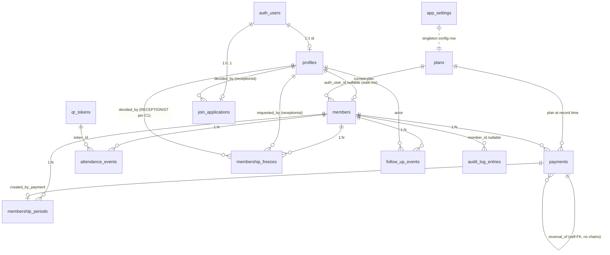

# Phase 3A Review Report — Decision Reconciliation & Design Validation

Date: 2026-11-17 · Status: DESIGN ONLY (read-only) · Phase 3B NOT authorized

Scope: reconciles the confirmed freeze-approval decision, registers every outstanding
decision (Q2–Q12) with implementation-vs-documentation evidence, analyzes the payment
reversal design, and validates the proposed schema, RLS matrix and database functions for
mutual consistency. This report does not modify any application source, documentation, or
database; it is a new standalone document.

---

## 1. Confirmed Decisions

| ID | Decision | Status | Design consequence |
|---|---|---|---|
| C1 | **Membership freeze approval = RECEPTIONIST.** The receptionist records *and* approves/rejects freeze requests. The Owner is **view-only** (history + decisions). Every decision is audit-logged and enforced **server-side** (security-definer function + RLS), not in the UI. | **CONFIRMED** (user, 2026-11-17) | `decide_freeze()` requires the receptionist role; Owner is explicitly refused. `membership_freezes.decided_by` now references the receptionist profile. Overrides `freeze.tsx` doc-block, `SECURITY_POLICY.md` RLS matrix ("Owner approves"), and `DATABASE_DESIGN.md` wherever they said Owner. Application UI code is NOT touched in this phase — the demo screen never approves anything today, so no functional code change exists yet; the doc-block text will be corrected when the live wiring lands (Phase 3B/4). |

Note: as a direct consequence, if no receptionist account exists, freeze decisions stall
(the Owner cannot step in). This is the literal reading of the confirmed decision and is
recorded as an accepted consequence, not re-opened.

## 2. Pending Decisions Register (Q2–Q12 + new sub-questions)

Every item below is **PENDING** — the user confirmed only C1. Recommendations are
proposals informed by actual code behavior; nothing here is treated as approved.

### Q2 — Discount authority (PENDING)
- **Implementation**: `fees.tsx` clamps the desk discount to **0–50** (integer, exactly typed or rejected). `member.discountPct` (5%, 10% in demo) is a standing per-member discount that "flows through as-is". No UI anywhere grants >50%.
- **Documentation**: `SECURITY_POLICY.md` RLS matrix says Receptionist INSERTs payments, Owner full CRUD — no discount ceilings defined anywhere.
- **Recommendation**: **fixed database enforcement first** (not configurable): `create_payment()` and a new `set_member_discount()` enforce receptionist ≤ **50%**, owner ≤ **100%**, values validated server-side (the client never submits `payable`). Configurable ceilings (columns on `app_settings`) can be added later without schema churn.
- **DB/security implications**: a CHECK constraint cannot know the actor, so the ceiling must live in the security-definer functions (role-checked) + audit entry on every discount write. Member-level standing discount is written only via `set_member_discount()`.
- **Unresolved assumptions**: (a) does the standing member discount auto-apply to the member's payments, or is it informational/prefill with the per-payment discount authoritative? Demo suggests per-payment entry is what computes `payable`; (b) is the owner's true ceiling 100% or something lower (e.g. 90%)?

### Q3 — Price lock (PENDING)
- **Implementation**: `fees.tsx` — renewal of the member's **own plan uses `priceLocked`** and is "never silently replaced by the current plan price"; a **new/different plan uses the currently configured plan price**. `plans.tsx` — a plan assignment is recorded as **pending** and "applies with the member's next verified payment"; historical records are never touched.
- **Documentation**: `BUSINESS_RULES.md` says the locked price holds "during the active subscription period" (narrower than the code); AGENTS.md says "existing subscriptions keep the price they joined at".
- **Recommendation**: adopt the **code** semantics, which are stronger and concrete: (1) same-plan renewal → `price_locked` forever (per member, until plan switch); (2) plan switch → `pending_plan_id`, applied atomically by `verify_payment()` at the next verified payment: new `price_locked = plans.price` at that moment, `plan_id` updated, pending cleared, all audited; (3) historical `payments` and `membership_periods` rows keep their original amounts/dates — a price change affects only future/switching members.
- **Consequences for historical data**: past payment rows and periods are immutable and are never recalculated; revenue history stays exact; the member's `price_locked` transitions are reconstructible from `audit_log_entries`.
- **Schema refinement discovered (see §6)**: `price_locked` must be **nullable until the first verified payment** (a freshly approved member has no payment yet, so no locked price exists).
- **Assumptions**: the first locked price is taken from `plans.price` **at the moment of the first verified payment** (not at application submission) — consistent with "applies when the next verified payment is processed".

### Q4 — Membership duration & freeze extension (PENDING — no formula implemented)
- **Implementation**: no duration→validity mapping exists anywhere in code; `freeze.tsx` explicitly states the extension calculation is **not defined** ("owner-set rules that arrive with the backend"). Demo `membershipEnd` values are arbitrary.
- **Documentation**: `DATABASE_DESIGN.md` says validity is pushed by "`ends_at - freeze_until` on approval" — vague and internally inconsistent.
- **Option A — calendar-month validity**: monthly=+1 month, quarterly=+3, half-yearly=+6, yearly=+12, via Postgres `interval` on `date`. Leap years and month-ends: Postgres clamps automatically (Jan 31 + 1 month = Feb 28/29; Feb 29 yearly → Feb 28 next non-leap year). Keeps the renewal day-of-month stable; months have unequal day counts (a "monthly" membership spans 28–31 days).
- **Option B — fixed-day validity**: 30/90/182/365 days. Uniform day counts; drifts the renewal day-of-month; yearly=365 loses a day every leap cycle (or 366 breaks uniformity).
- **Recommendation**: Option A (calendar-month) — it matches how gyms and members talk about memberships, and native interval clamping is deterministic and testable. **Not implemented until confirmed.**
- **Freeze extension on approval**: the requested window `start_date..end_date` yields `extension_days`. Options: (a) **inclusive of both days** (`end − start + 1`), (b) **exclusive of start** (`end − start`). On approval: `is_frozen = true`, and `membership_end` advances by `extension_days` **only if the member was active/expiring at request time** (eligibility already enforced). **Do not implement an assumed formula — needs the user's pick.**
- **Renewal timing**: before expiry → extend from current `membership_end` (stacking). After expiry → Option A2: extend from old end (retroactive coverage, member-friendly), Option A3: extend from payment date (no free coverage). A grace window (e.g. N days after expiry still renews from old end) is undefined — **sub-question Q4c**.
- **Early unfreeze** (the demo screen is "Freeze / Unfreeze"): what happens to the extended `membership_end`? Options: (i) end stays extended (time banked), (ii) end is recomputed back (proportional). **Sub-question Q4b.**
- **DB implications**: all date math lives in `verify_payment()` and `decide_freeze()` on `date` columns (matching the app's calendar-day rule, immune to 23:59/00:01 and DST); every computed extension is written to `membership_freezes.extension_days` and audited.

### Q5 — Money representation (PENDING)
- **Implementation**: whole-rupee math (`Math.round(price × (1 − d/100))`); `parsePlanPrice` accepts at most 2 decimals; all demo amounts are integers (INR).
- **Documentation**: `DATABASE_DESIGN.md` proposes "currency minor units" (paise).
- **Comparison**: `numeric(12,2)` major units — exact decimal arithmetic in SQL (`SUM` is exact, no float), matches the app's existing rounding exactly, human-readable rows; minor-units (`bigint` paise) — integer purity, but forces the app to divide by 100 everywhere and contradicts the app's whole-rupee rounding, with no precision benefit at gym price scales.
- **Recommendation**: `numeric(12,2)` + `currency char(3) CHECK (currency = 'INR')` (single currency enforced). Rounding rule stated explicitly: `payable = round(original_price × (1 − discount/100.0), 0)` — i.e. whole rupees, stored as `…​.00`, **identical** to `computePayable`. Discount amounts therefore never produce sub-rupee values.
- **Assumption**: single-currency gym (INR only) — confirm.

### Q6 — Attendance QR rotation (PENDING)
- **Implementation**: the payload is an inert demo string; `door-qr.tsx` states server-generated tokens with server-set expiry, "no duration is defined yet". No token generation/validation exists client-side (verified by inspection).
- **Documentation**: `SECURITY_POLICY.md` says "time-limited … single-use" and (D6, outdated) that members "generate (own)" tokens — contradicted by the implemented door-displays/member-scans model.
- **Recommended design**: token is **time-limited and server-minted**; the door screen obtains the current plaintext via `mint_attendance_token()` (staff-only, transient return value). Validation is server-side in `check_in(token_plaintext)`: SHA-256 hash → lookup → expiry check → membership gate (expired → `failed`, frozen → `frozen`) → insert. **Replay protection without breaking "multiple check-ins per day"**: a token is reusable *within its validity window by different members*, but **unique `(member_id, token_id)`** means the same member can consume a given token only once — screenshot replay fails on expiry, double-tap fails on uniqueness. Plaintext is never stored (`token_hash` only). Purge > 30 days.
- **60-second validity**: proposed default; shorter shrinks the replay window but increases mint traffic; the door screen would auto-refresh. Needs confirmation.
- **Open point**: "single-use" in the security policy must be reinterpreted as *per-member-per-token* (as above) — a strictly single-use token would lock out the second member at a busy door.

### Q7 — Report definitions (PENDING)
- **Implementation**: `DailyReportNumbers` shows `attendance 41, uniqueVisitors 34, checkInEvents 41` — internally inconsistent (attendance == events ≠ visitors); `home.tsx` computes verified UPI/cash from payment records; the calendar counts **verified events only**.
- **Recommended definitions** (all derived in SQL, nothing stored):
  - `check_in_events` = COUNT(`attendance_events` WHERE `status='verified'` AND gym-date = D)
  - `unique_visitors` = COUNT(DISTINCT `member_id`) with the same filter
  - `attendance` ≡ `unique_visitors` (distinct members present) — **needs the user's pick** vs "≈ events"
  - `new_members` = COUNT(`membership_periods` with `start_date = D` and no earlier period for that member)
  - `renewals` = COUNT(`membership_periods` with `start_date = D` and an earlier period)
  - `verified_collections` = SUM(`payable`, `state='verified'`) split by `method`
  - `discounts` = SUM(`original_price − payable`) over verified payments that day
  - `refunds` = SUM(verified **reversal** rows that day)
- **Sub-question Q7b**: revenue reported by **record date** (demo behavior) or **verification date** (revenue-recognition view)? Verification date is recommended; demo uses record date.

### Q8 — Cash verification / self-approval (PENDING)
- **Implementation**: every entry (UPI *and cash*) is recorded `awaitingVerification`; the demo's only verified payment shows `verifiedBy: 'Owner'`; nothing verifies.
- **Recommendation**: segregation of duties — **the person who recorded a payment cannot verify it**. Two variants:
  - **Option A (strict)**: no self-verification for anyone (receptionist or owner).
  - **Option B (pragmatic)**: receptionist can never self-verify; the Owner *may* self-verify, gated by MFA (AAL2) and audit.
  - Option B avoids a deadlock when the gym has a single staff account (under Option A, an owner-recorded cash payment could never be verified). Consequence of B: owner self-approval is possible but fully audited. **Needs the user's pick.**
- **DB/security implications**: enforced inside `verify_payment()` (compare `recorded_by` to actor; reject with a coarse error), plus the MFA gate; audited either way.

### Q9 — Entry/exit (PENDING)
- **Implementation**: `door` is a **text location label** ("Main entrance"); one row per scan; no exit concept.
- **Documentation**: `DATABASE_DESIGN.md` says `door Boolean` (entry/exit flag) — contradicted by code.
- **Recommendation**: label-only. No current feature needs pairing (member calendar, daily counts and the 30-day rule all work on verified events). If occupancy/exit tracking is ever wanted, an additive `direction` enum column + paired events can be added without breaking anything.
- **Limitation accepted**: "who is in the gym right now" is not computable.

### Q10 — Member UTR submission (PENDING)
- **Implementation**: no member-side payment submission screen exists; `SECURITY_POLICY.md` explicitly grants "Members: INSERT (own only)" on payments.
- **Recommendation**: keep the RLS grant as designed: a member may INSERT into `payments` only for themselves, only `method='upi'` with their `utr`/`note`, and `original_price`/`discount_pct`/`payable` are **overwritten server-side** (trigger or INSERT guard) — the row lands `awaitingVerification` and follows the identical verification path as desk entries. UI arrives in a later part.
- **Assumption**: member submission is limited to renewals/payments for their own active or expiring membership (not arbitrary members) — enforced in the INSERT trigger.

### Q11 — Data retention (PENDING — no legal claims made)
- **Implementation**: everything is in-memory; no retention behavior exists.
- **Recommendation**: financial records (`payments`, `membership_periods`), `audit_log_entries` and `attendance_events`: retained **indefinitely** (audit is append-only; attendance underpins the 30-day rule and history). `qr_tokens`: purge > 30 days. Rejected `join_applications`: anonymize after a configurable window (proposed 90 days). Member erasure request: **anonymize** the member row (name/phone/email, unlink auth) while financial rows remain (they are the books) — deletion of financials is refused by design.
- **Needing legal confirmation (not invented here)**: India DPDP Act obligations for PII retention/deletion; statutory bookkeeping/tax record retention period. Until confirmed, nothing is auto-purged except QR tokens.

### Q12 — UPI settings ownership (PENDING)
- **Implementation**: reception edits the gym UPI id/QR image in a **session-only** demo store (`updateSessionQrConfig`); resets on restart.
- **Documentation**: none.
- **Recommendation**: Owner-only `UPDATE` via `update_gym_settings()` (audited); **receptionist keeps read** (the payment-QR display and the fees flow need `upi_id` to build the payable-bearing UPI link). RLS: `SELECT` all authenticated; direct `UPDATE` denied to everyone (function-only).

## 3. Payment Reversal Design Analysis

**Representation — chosen: positive amount + explicit type.**
A reversal is a **new `payments` row** with `entry_type='reversal'`, `reversal_of` → the original, and a **positive** `payable`. Signed-negative rows were rejected: they break the uniform `CHECK (payable > 0)`, mix signs into aggregates, and make double-count mistakes easy. The original row keeps `state='verified'` **unchanged** — no `reversed` status exists (deliberate deviation from `DATABASE_DESIGN.md`'s "status → reversed": status mutation is exactly the "reversals are edits-not" anti-pattern; net revenue reflects the reversal instead).

**Partial vs full reversals.** "No partial payments" governs *payments*; refunds may legitimately be partial. Proposed: reversal `amount ≤ original.payable − SUM(verified reversals of that original)`; a full reversal is simply the remaining balance. Created **owner-only, instantly `state='verified'`** (owner authority + MFA + audit) — reversals do not enter the awaiting queue. *(PENDING: confirm owner-only, and whether partial refunds are wanted at all.)*

**Over-reversal prevention.** `create_reversal()` computes the remaining reversible amount in the same transaction; attempts beyond it are refused. Cumulative reversals can never exceed the original's verified amount.

**Immutability.** The BEFORE UPDATE/DELETE trigger blocks changes to `member_id, plan_id, original_price, discount_pct, payable, currency, method, entry_type, reversal_of, recorded_by, utr` on **every** payments row (original and reversal alike); `reversal_of` carries a `CHECK`-validated reference (must point to a `payment`, never another reversal — no chains).

**Revenue & reports.** `verified_revenue = SUM(payable | entry_type='payment' AND state='verified') − SUM(payable | entry_type='reversal' AND state='verified')`. `awaitingVerification` and `rejected` rows are **never** revenue (existing `monthPaymentTotals` semantics). The daily report's `refunds` = verified reversals that day.

**Receipts.** The original receipt is never modified; each reversal can carry its own receipt (`receipt_issued`, `receipt_path`) referencing `reversal_of`.

**Worked example (INR):**
| Date | Row | Type | Amount | State | Effect |
|---|---|---|---|---|---|
| Jan 10 | P1 (Arjun, quarterly renewal, 0% disc, UPI) | payment | 3000 | awaiting → **verified Jan 10** (owner) | period created Jan 10→Apr 10; revenue +3000 |
| Jan 15 | R1 (partial refund) | reversal | 1000 | verified instantly (owner+MFA) | revenue −1000; net 2000; reversible remainder 2000 |
| Jan 16 | R2 attempt 2500 | reversal | — | **refused** | 2500 > remaining 2000 |
| Jan 16 | R2 corrected (full remaining) | reversal | 2000 | verified | net 0 |
| Jan 10 report | | | | | collections 3000, refunds 0 |
| Jan 15 report | | | | | collections 0, refunds 1000 |
| Jan 16 report | | | | | collections 0, refunds 2000; month net 0 |

**New sub-question Q13 (PENDING)**: does a **full** reversal void the membership it paid for (i.e. `membership_end` rolls back / the period is ended)? The demo domain has no concept for this; needs a rule before implementation.

## 4. Design Validation

**Table necessity (12 tables — no duplicates found):**
`profiles` (roles; 1:1 auth), `plans` (single source of plan data — matches `plans.tsx` "no duplicate plan tables"), `members` (person + subscription state), `membership_periods` (renewal history + verification side-effects + report counts — the only non-obvious table, justified above), `payments` (+ reversals, append-only), `attendance_events`, `membership_freezes`, `join_applications`, `follow_up_events` (replaces the demo's embedded single follow-up with the history the lost-list screen claims: "tracked per member with the actor recorded"), `qr_tokens`, `audit_log_entries`, `app_settings` (singleton). Pending plan assignment is **columns on members** (`pending_plan_id`, `pending_plan_requested_by`) rather than a 13th table — one assignment at a time is the real-world case and it removes a workflow table.

**Foreign keys & deletion behavior:** every domain FK is **RESTRICT** — `members` are archived (`archived_at`), plans are deactivated (`is_active`), payments/periods/audit are never deleted. Only `profiles.id` and `join_applications.auth_user_id` cascade from `auth.users` (account deletion cleans the profile). `qr_tokens` purge applies only to tokens not referenced by attendance events (events keep their token reference for audit).

**Role immutability:** trigger refuses `UPDATE profiles.role` for every client role (only `service_role` may change roles); `INSERT` of an owner profile is likewise service-only (owner accounts are created via the Owner/invite flow, per the Part 2 stance "staff accounts are created by the Owner, never through public registration"). Client-facing UPDATE on profiles is denied; any future display-name edit goes through a function.

**RLS ↔ function consistency (the requested check) — revised for C1:**

| Operation | Function (security definer) | Role gate | Writes to (RLS posture) | Audit |
|---|---|---|---|---|
| Record payment (desk or member) | `create_payment` | staff or self-member | `payments` (client INSERT allowed with server-side overrides) | payment_created |
| Verify payment | `verify_payment` | staff + **MFA**, **not** `recorded_by` (Q8) | `payments.state`, `membership_periods` INSERT, `members` (end/plan/locked-price) — all bypassed *by the function*, never by the client | payment_verified |
| Reject payment | `reject_payment` | staff + MFA, not `recorded_by` | `payments.state` | payment_rejected |
| Create reversal | `create_reversal` | **owner** + MFA | `payments` INSERT (verified) | payment_reversed |
| Freeze request | `request_freeze` | receptionist | `membership_freezes` INSERT | freeze_requested |
| **Freeze decision** | `decide_freeze` | **receptionist** (C1 — owner refused) | `membership_freezes.state/decided_*`, `members.is_frozen/membership_end` | freeze_approved / freeze_rejected |
| Join application decision | `decide_application` | receptionist (user rule) | `join_applications.state`, `members` INSERT/link | application_approved/rejected |
| Mint/display door token | `mint_attendance_token` | staff + MFA | `qr_tokens` INSERT; returns plaintext transiently | token_minted |
| Check-in | `check_in` | member (self) | `attendance_events` INSERT | — (attendance rows are their own log; excluded from audit by design) |
| Plan price / assignment / discount | `update_plan_price`, `request_plan_assignment`, `set_member_discount` | owner / staff / staff per ceilings | `plans.price`, `members.pending_*`, `members.discount_pct` | price_updated / assignment_requested / discount_set |
| Settings | `update_gym_settings` | owner | `app_settings` | settings_updated |

**Technical note on definer functions and RLS:** in Supabase, a `security definer` function owned by the table owner executes **bypassing RLS** for its own writes — that is precisely the design: RLS locks *direct client* access; each function re-checks the actor's role/MFA itself and writes through the definer path. Functions pin `search_path`, avoid `anon`/`authenticated` invoker privileges beyond `EXECUTE`, and never trust client-supplied money or dates. Consistency finding: with C1, the previous draft's "owner approves freeze" path is removed; no function or policy retains owner-side freeze writes.

**MFA requirements:** AAL2 (`auth.jwt() ->> 'aal' = 'aal2'`) required for `verify_payment`, `reject_payment`, `create_reversal`, `decide_freeze`, `decide_application`, `mint_attendance_token`, `update_plan_price`, `update_gym_settings` — matching the Part 2 rule that staff pass MFA before authority.

**Token lifecycle:** `mint (staff)` → displayed ≤ validity (Q6, proposed 60s) → member scan → `check_in` validates hash/expiry/membership → event row (unique per member+token) → expiry → purge > 30 days (tokens never referenced by events are dropped; referenced ones retained for audit).

**Audit completeness:** every authority-bearing write in the table above emits an `audit_log_entries` row (actor, role, action, table, row id, old/new jsonb). Explicitly excluded: routine reads, `check_in` inserts (their own table is the log), token expiry/purge.

**Membership status derivation:** `v_member_status` reproduces `utils/membership.ts` exactly: `is_frozen → frozen`; `membership_end IS NULL → pendingPayment`; else date rule on `membership_end` vs `gym_date()` — `< 0` expired, `≤ 7` expiring, else active; `NULL`-and-unfrozen with no payment ever surfaces as pendingPayment until the first verified payment. No stored status column anywhere (D1 resolved in the code's favor).

**Conflicting-rule sweep:** multiple-check-ins/day ↔ unique `(member_id, token_id)` — consistent (different tokens across the day); pending ≠ revenue ↔ all report functions filter `state='verified'` — consistent; UPI QR ≠ attendance QR — consistent (`qr_tokens.purpose` CHECK + structurally separate screens; the payment QR is built from `app_settings.upi_id`, never a token); no-partial-payments ↔ `payable` computed as the full discounted amount — consistent; 30-day inactivity ↔ verified-events-only filter — consistent (frozen/failed rows are records, not attendance).

**Documentation drift (to fix in docs only after approval — not modified now):** C1 freeze approver (SECURITY_POLICY matrix, DATABASE_DESIGN implications); D6 "member generates own token" → door-displays model; D2 payment state names + reversal-not-status; D3 door Boolean → text label; D4 minor units → decision Q5; D7 price-lock phrasing; D1 stored status → derived view; plus new: "single-use" reinterpretation for QR tokens (Q6).

## 5. Revised ER Diagram (receptionist freeze approval)

## 6. Revised Table & Relationship Recommendations

Only two refinements surfaced from this review (no new tables, none removed):
1. **`members.price_locked` becomes nullable** (`numeric(12,2) NULL CHECK (price_locked IS NULL OR price_locked > 0)`) — set by `verify_payment()` at the first verified payment; `NOT NULL`-forever was wrong for freshly approved members (Q3 finding).
2. **`membership_freezes`** gains an explicit `ended_at timestamptz NULL` (early unfreeze, Q4b) and keeps `decided_by` pointing at the **receptionist** profile; the previous draft's owner-approval note is void.

Everything else stands as proposed in the Phase 3A design report (12 tables, RESTRICT deletes, definer-function authority, audit triggers, `v_member_status` view).

## 7. Revised Security Policy Matrix (freeze row updated per C1)

| Table | Member | Receptionist | Owner | Anon / service |
|---|---|---|---|---|
| `profiles` | SELECT own | SELECT all (others: name/role only) | SELECT all | service: full |
| `plans` | SELECT (active) | SELECT | SELECT (writes via function) | service: full |
| `members` | SELECT own | SELECT all; INSERT walk-in; UPDATE contact via function | SELECT all | service: full |
| `membership_periods` | SELECT own | SELECT all | SELECT all | service: insert |
| `payments` | SELECT own; INSERT own (server-overridden fields) | SELECT all; INSERT | SELECT all; INSERT | service: full |
| `attendance_events` | SELECT own | SELECT all | SELECT all | service: insert |
| `membership_freezes` | SELECT own | **SELECT all; INSERT request; decide via function (C1)** | **SELECT all (view-only — no decision rights)** | service: full |
| `join_applications` | SELECT own | SELECT; decide via function | SELECT | service: insert |
| `follow_up_events` | — | SELECT all; INSERT | SELECT all; INSERT | — |
| `qr_tokens` | none | none (plaintext via function only) | none | service: full |
| `audit_log_entries` | — | — | SELECT | service: insert |
| `app_settings` | SELECT | SELECT | SELECT; UPDATE via function | — |

Direct `UPDATE`/`DELETE` grants are revoked on `payments`, `membership_freezes`, `join_applications`, `audit_log_entries`, `qr_tokens` — those states change only through the definer functions.

## 8. Remaining Technical Risks

1. **Definer-function bugs bypass RLS by design** — the authority layer is only as good as its role checks; mitigations: function-level tests (Phase 3B local suite), pinned `search_path`, no `EXECUTE` for anon on authority functions, mandatory code review.
2. **Signup hook dependency** — creating `join_applications` rows requires a trigger on `auth.users` (or Supabase Auth hook); must be verified against the actual Supabase Auth configuration before Phase 3B.
3. **MFA enforcement depth** — AAL2 checks in functions depend on Supabase Auth MFA enrollment being mandatory for staff; a staff account without an enrolled factor would fail all gated operations (safe failure, but operationally notable).
4. **Freeze deadlock consequence (C1)** — with no receptionist account, freezes stall; Owner cannot step in (accepted per C1).
5. **Clock/timezone** — all calendar rules run on `gym_date()` (configurable timezone); device-local dates are display-only.
6. **Token shoulder-surfing** — a bystander photographing the door QR inside its validity window can check in as themselves (they still need a member account); per-member uniqueness and expiry bound the damage.
7. **Storage for receipts** is deferred (bucket + paths in a later phase); `receipt_path` columns exist but unused until then.
8. **Partial-reversal + membership interplay** unresolved (Q13) until answered.

## 9. Questions Requiring User Input (all PENDING)

Primary: **Q2** discount ceilings (and whether the standing member discount auto-applies); **Q3** confirm code semantics for price lock; **Q4** duration model (calendar-month vs fixed-day), freeze extension inclusivity, early-unfreeze effect (Q4b), renewal-after-expiry base + grace window (Q4c); **Q5** confirm numeric(12,2) INR whole-rupee rounding; **Q6** confirm 60s rotation + per-member-per-token replay rule; **Q7** attendance definition + record-vs-verification-date reporting (Q7b); **Q8** self-verification Option A vs B; **Q9** confirm label-only doors; **Q10** confirm member-side UTR submission scope; **Q11** retention windows (pending legal confirmation — not invented here); **Q12** confirm owner-only UPI settings; **Q13** full-reversal membership effect; reversal authorship (owner-only?) and partial-refund allowance.

## 10. Final Recommendation — Phase 3B Readiness

The design is **structurally ready** for Phase 3B: the schema absorbs the confirmed C1 decision without structural change (function role-gate + audit only), no table additions/removals, and the two refinements in §6 are mechanical. **However, Phase 3B (writing migrations) should not start until at least Q2, Q4, Q5, Q7, Q8 and Q13 are answered**, because they determine concrete constraint and function logic. Q3/Q6/Q9/Q10/Q11/Q12 have safe defaults (documented above) and can proceed on defaults if you prefer, with the decision register updated to record them as adopted-by-default.

---

*End of Phase 3A review. No SQL written, no source or docs modified, no CLI link, nothing committed.*
